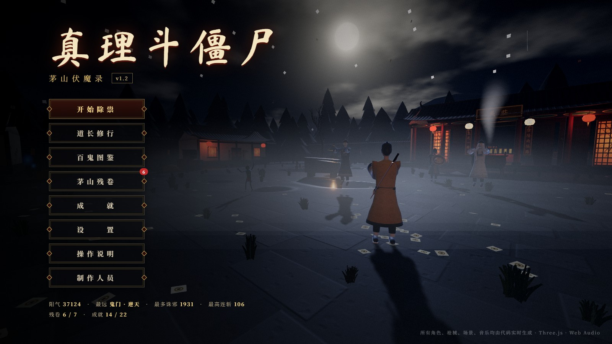
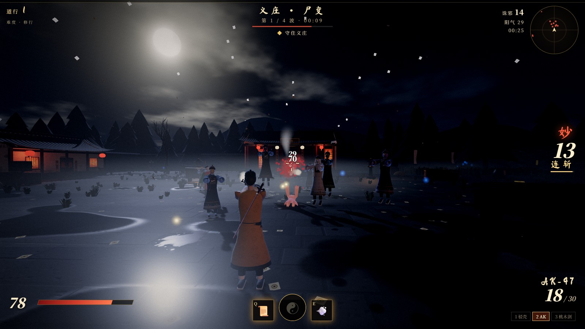
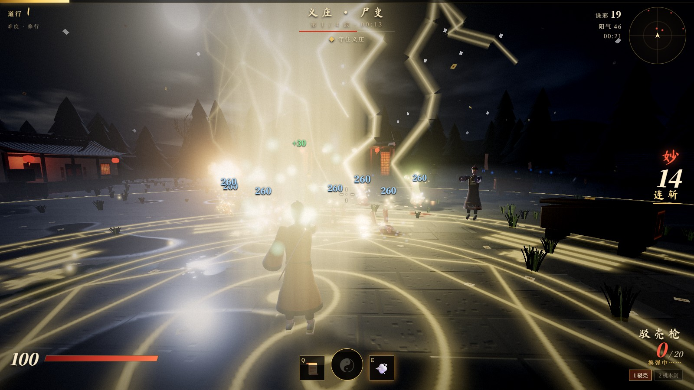
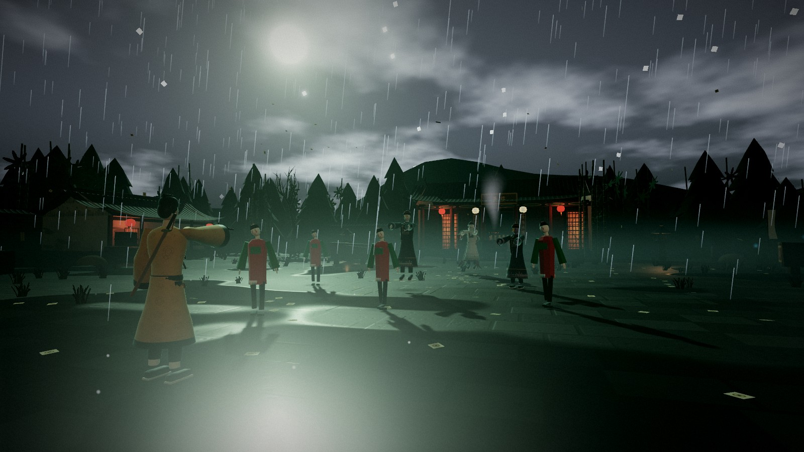
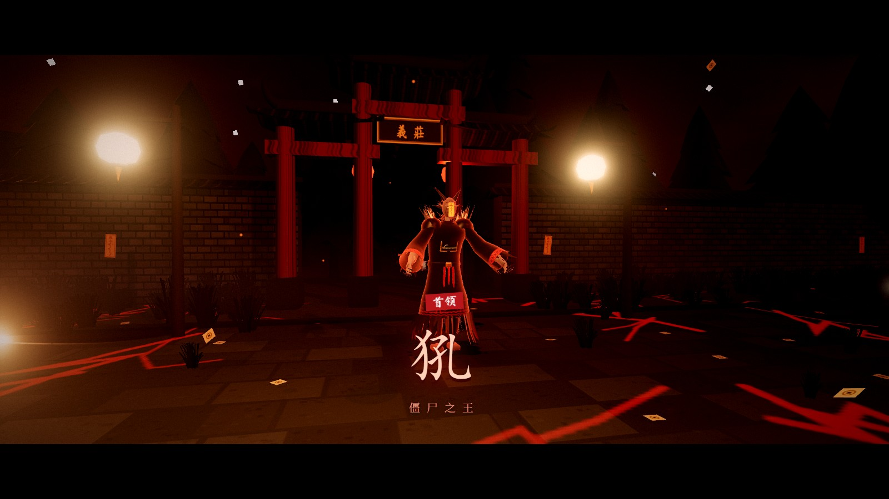
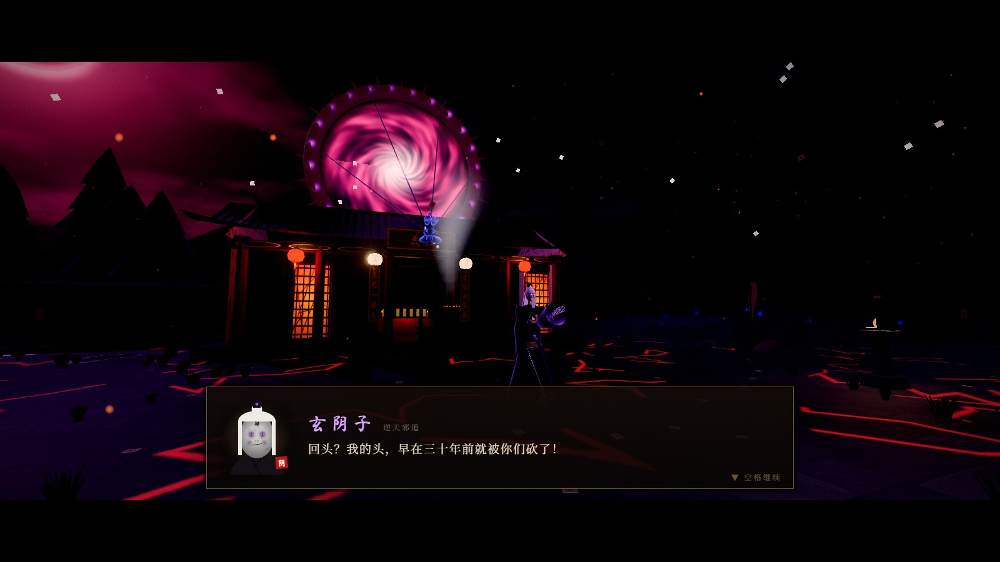
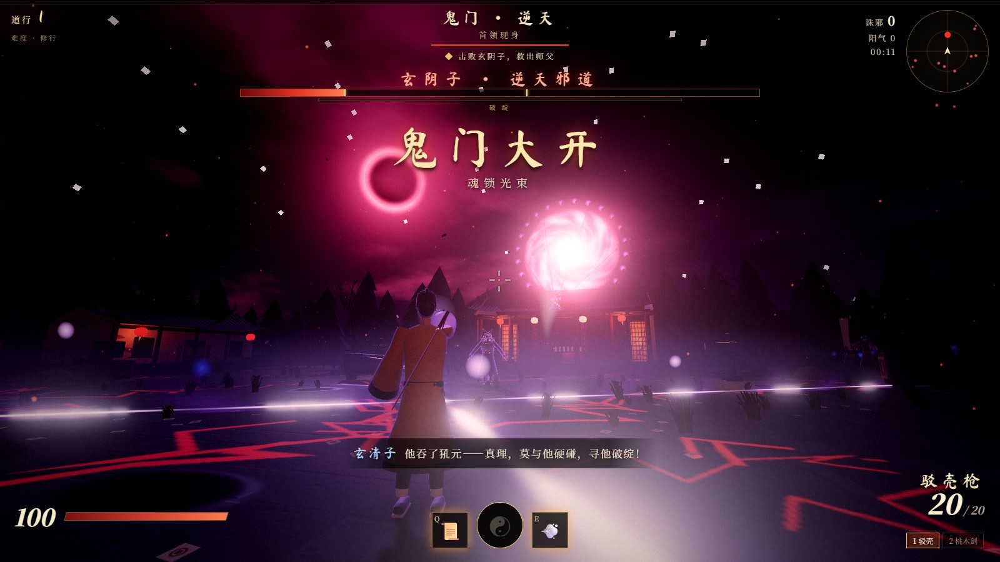
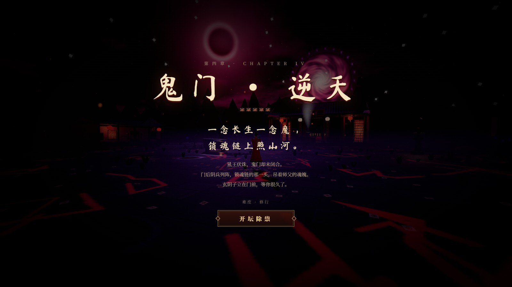
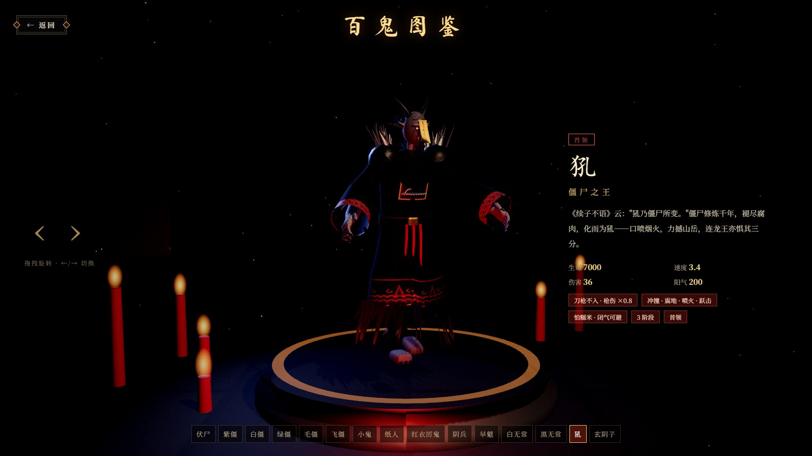

# 真理斗僵尸 · 茅山伏魔录（v1.2）

**▶ 在线游玩：<https://liyucheng1997.github.io/218_game-jiangshi-fighting/>**（桌面浏览器，键鼠或手柄）

基于 **Three.js** 的中国志怪题材 **剧情向 Roguelite 射击游戏**。民国十三年，湘西。
你是茅山弟子 **真理**——师父玄清子赴落霞村查案未归，义庄的棺材板，在七月十二的子夜响了。

黑符养尸、纸扎还魂、无常被拘、鬼门洞开……四个章节，一路追查到三十年前被逐出山门的师叔 **玄阴子**。
集齐七卷 **茅山残卷**，或许能改写某个人的结局。

> 所有角色、枪械、场景 **由代码实时建模**；所有音乐、音效、环境声 **由代码实时合成**——没有任何外部模型、贴图或音频文件。



| | |
| --- | --- |
|  |  |
| 第一章 · 义庄夜战（月光、湿石板积水、尸群） | 天师降魔 · 八卦法阵与五雷 |
|  |  |
| 第二章 · 夜雨荒村，纸人列阵 | 第三章 · 首领登场特写 · 犼 |
|  |  |
| 第四章 · 鬼门前，锁魂链下的师父 | 最终战 · 日食 · 魂锁光束 |
|  |  |
| 书法章节卡与题诗 | 百鬼图鉴 · 灵堂供台 |

## 运行

```bash
npm install
npm run dev        # 开发：http://localhost:5173（或 5208，见 .claude/launch.json）
npm run build      # 打包到 dist/
```

## 剧情与章节

| 章节 | 场景 | 首领 | 看点 |
| --- | --- | --- | --- |
| 序章 | 义庄 · 别师 | — | 师父远行，留下驳壳枪与传音符 |
| 第一章 · 义庄 · 尸变 | 月夜义庄 | **旱魃**（三阶段：火环 → 赤地真火 → 焚天陨火） | 尸身上的倒书黑符 |
| 第二章 · 荒村 · 纸扎 | 夜雨荒村、竹林 | **黑白无常**（同生共死：一方陨落另一方暴怒） | 无常竟是被"拘魂令"驱使 |
| 第三章 · 阴司 · 鬼门 | 血月、地裂熔光、鬼门初开 | **犼**（三阶段：冲撞震地 → 喷火 → 腾空跃击） | 犼不过是开门的钥匙 |
| 第四章 · 鬼门 · 逆天 | 日食血月、鬼门大开 | **玄阴子**（人形 → 尸化 → 鬼门大开·魂锁光束） | 锁魂链那头，是师父的魂魄 |

- **两种结局**：普通结局与真结局（需跨局集齐七卷茅山残卷）。
- **过场演出**：章节开场运镜 + 遮幅黑边 + 书法章节卡；首领登场特写；首领伏诛慢镜头环绕；黎明终章与片尾字幕。
- **对白系统**：程序绘制的水墨立绘、打字机效果、按角色区分音色的"嗓音"；战斗中有师父的传音、宿敌的嘲讽。
- 首次观看完整演出，之后自动缩短；随时 Esc / 空格跳过。

## 玩法

- **章节战役**：限时波次持续刷怪 → 首领战 → 剧情 → 择一件法宝；通关后开启 **无尽轮回**。
- **四档难度**：入道（剧情）· 修行（标准）· 伏魔（困难，精英双词缀）· 天劫（噩梦，通关伏魔后解锁）。
- **AI 导演**：根据受伤、残血、近身敌数实时调节节奏（蓄势 → 高潮 → 喘息）；波次中段会掀起有方位预警的 **尸潮**。
- **精英词缀**：迅捷 / 铁甲 / 爆裂（死后尸爆）/ 分身 / 吸魂 / 符护（火与道法可破）/ 狂暴 / 招魂，头顶标注。
- **首领破绽**：持续输出、爆头、道法会累积破绽槽，满槽时首领跪地，伤害 ×1.6。
- **预兆纹样**：所有大招都有地面预警，纹样由内向外填满之时便是落下之刻。
- **罡步 · 灵台清明**：在敌人出手的一瞬间冲刺闪避，触发子弹时间、刷新冷却、充能大招。
- **闭气**（按住 C）：僵尸靠嗅人气寻人——闭气时它们会原地嗅探、失去踪迹（对鬼怪与首领无效）。
- **连斩**：连续击杀提升阳气与大招充能，评级 妙 / 绝 / 神 / 圣 / 仙；受伤即中断。
- **阴兵**：虎头盾挡住正面枪弹，三人成列推进——绕其侧背或以道法破之。
- **道行升级**：9 种茅山道术、17 种修身、4 把新兵器与改良、4 种进阶道法；8 件法宝。
- **局外修行**：阳气永久强化生命、移速、枪伤、火符、悟性、福缘、龟息、踏罡。
- **百鬼图鉴 · 茅山残卷 · 22 项成就**。

## 操作

| 键鼠 | 手柄 | 功能 |
| --- | --- | --- |
| W A S D / Shift / 空格 | 左摇杆（推满疾跑）/ A | 移动 / 疾跑 / 跳跃 |
| 鼠标 | 右摇杆（含瞄准辅助） | 视角 |
| 鼠标左键 | RT | 射击 / 挥桃木剑 |
| 右键 / Q | LT | 掷火符 |
| E | B | 罡步冲刺（无敌；把握时机触发灵台清明） |
| 按住 C | R3 / 十字下 | 闭气 |
| F | Y | 天师降魔 |
| 1~6 / 滚轮 · R | LB / RB · X | 切换武器 · 换弹 |
| V | Back | 第一 / 第三人称 |
| Esc | Start | 暂停（对白中：空格继续 / Esc 跳过） |

## 技术要点

- **画面**
  - 程序化 **IBL 环境光照**（按章节烘焙夜空、月晕、远处灯火 → PMREM），金属与湿石板获得可信反射。
  - **体积感高度雾**：替换 three 的雾片段着色器，贴地翻涌、朝月散射。
  - **月光体积光**（屏幕空间径向散射，屋脊、枯树遮挡出光束）、日食血月与日冕。
  - 后期管线：MSAA → 体积光 → Bloom → ACES → 显示空间调色（分离色调 / 对比 / 饱和 / 暗角 / 颗粒 / 色差 / 冲刺径向模糊 / 闪白 / 受伤红晕）。
  - 湿石板积水洼（程序噪声：低粗糙度、压平法线、倒映月光）；夜雨（GPU 线段，零 CPU）；天际闪电；随风摇曳的荒草（实例化）。
  - 阴影相机跟随玩家并按像素对齐；远处敌人只用脚底接触阴影。
  - 持久地面贴花（血泊、灵液、焦痕）。
  - 粒子特效：火焰 / 烟尘粒子用平铺噪声做溶蚀（白热内核 → 橙焰 → 暗红余烬、翻卷黑烟），爆炸分内核闪光、翻滚火球、烟柱、火星、冲击环与地面焦痕；八卦法阵为程序绘制的发光线描；光柱按视角淡出轮廓；闪电带白热截面与分叉。
  - 过场主光：首领登场、伏诛、对白特写时自动给主角 / 首领补一盏斜前上方的主光。
- **角色**（`src/gfx/`）
  - 程序化骨骼 + 自动蒙皮权重；"超级材质"：顶点 PBR 参数、**月光方向轮廓光**、**布料 / 符纸 / 发丝随风飘动**（顶点柔性权重）、跳跃时袍摆鼓起、**噪声溶解 + 余烬描边**的死亡焚化。
  - 新角色：阴兵（鱼鳞札甲 · 虎头盾 · 长枪）、玄阴子（人形 · 尸化两套模型共享一个实体）、玄清子（师父魂魄）。
  - 爆头：头颅崩碎、清朝官帽飞出、断颈喷血（可在设置中关闭血腥效果）。
- **音频**（`src/audio.js`）
  - 总线混音 + 软削波枪械总线 + 音乐闪避；程序生成卷积混响（庭院 / 竹林 / 洞窟）；HRTF 空间声。
  - **自适应配乐**：Karplus-Strong 古琴、琵琶轮指、二胡、箫、堂鼓、梆子、锣、钹、人声合唱，按战斗强度分层淡入淡出；邪道主题动机。
  - 章节环境声：夜风、虫鸣、乌鸦、檐铃、夜雨、竹响、地火、阴风鬼哭、锁链；对白"嗓音"按角色区分。
- **系统**：剧情数据集中于 `src/story.js`；对白 `src/dialogue.js`；过场 `src/cinematic.js`；成就 `src/achievements.js`；首领行为树 `src/bosses.js`；手柄 `src/gamepad.js`。

## 目录结构

```
index.html            全部界面（加载 / 主菜单 / 择道 / 章节卡 / 修行 / 设置 / 图鉴 / 残卷 / 成就 / HUD / 对白 / 选卡 / 暂停 / 结算 / 片尾）
src/main.js           状态机、剧情流程、战斗手感、主循环
src/story.js          剧情台词 · 题诗 · 战斗台词 · 茅山残卷 · 提示 · 片尾字幕
src/dialogue.js       对白（立绘 / 打字机 / 嗓音）与战斗字幕
src/cinematic.js      过场运镜、遮幅、书法章节卡
src/data.js           怪物图鉴 · 章节波次 · 难度 · 精英词缀 · 局外修行
src/director.js       章节导演（难度 / AI 导演 / 尸潮 / 首领 / 无尽轮回）
src/enemies.js        敌人 AI / 词缀 / 破绽 / 阶段 / 危险区 / 弹幕 / 溶解死亡
src/bosses.js         首领多阶段行为树
src/skills.js         茅山道术、修身、进阶、法宝、火符、天师降魔
src/weapons.js        武器系统
src/player.js         控制器（移动 / 跳 / 冲刺 / 闭气 / 手柄）
src/gamepad.js        手柄输入与瞄准辅助
src/achievements.js   成就
src/audio.js          音频引擎
src/postfx.js         后期管线
src/world.js          场景、氛围、雨、闪电、鬼门、荒草
src/gfx/              程序化建模：textures / rig / shapes / characters / anim / guns / fog / environment
tools/                开发用预览页（角色画廊、枪械、姿势）
```
